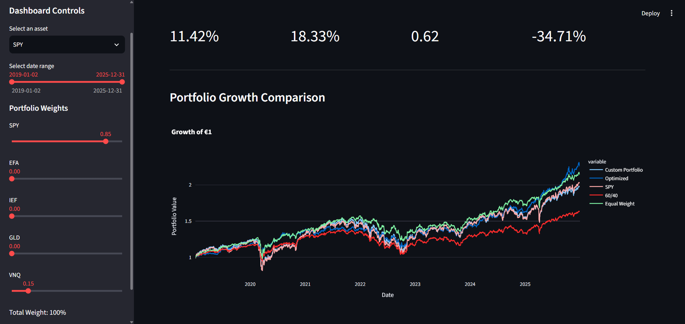
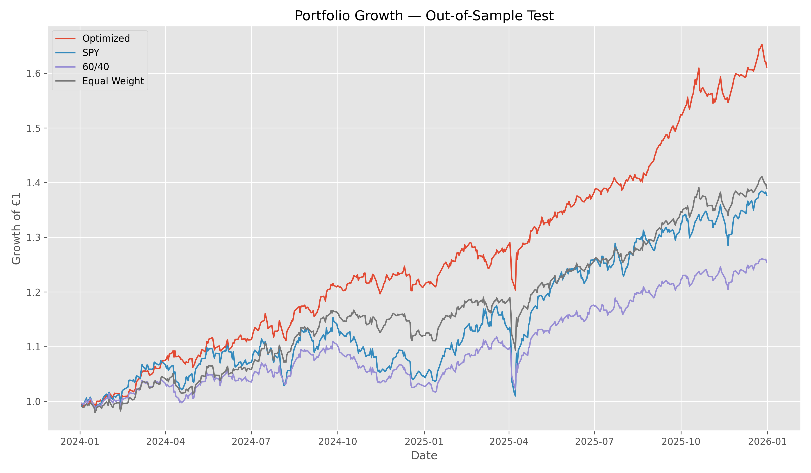
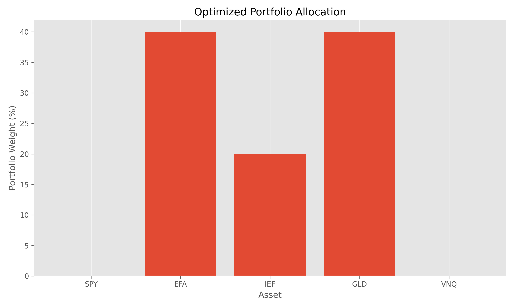

# Portfolio Optimization & Risk Analysis with Python

## Overview

This project combines **financial markets analysis, portfolio optimization, and data science using Python**.

The project analyzes a diversified portfolio of five asset classes:

* **SPY** — US Equities
* **EFA** — International Equities
* **IEF** — US Treasury Bonds
* **GLD** — Gold
* **VNQ** — Real Estate

Historical market data is used to analyze asset returns, volatility, correlations, Sharpe ratios, and drawdowns. A constrained portfolio optimization framework is then used to construct an allocation subject to a maximum 40% weight per asset.

The project also includes an **interactive Streamlit dashboard** that allows users to:

* Explore historical asset prices
* Select different analysis periods
* Analyze individual asset risk metrics
* Build custom portfolios
* Compare portfolio strategies
* Visualize portfolio growth
* Evaluate risk-adjusted performance

The objective is to demonstrate the application of **Python, statistics, financial analysis, and data visualization** to a practical portfolio-management problem.

## Technologies

* **Python**
* **Pandas** — data manipulation and analysis
* **NumPy** — numerical computation
* **SciPy** — portfolio optimization
* **yfinance** — historical market data
* **Matplotlib & Seaborn** — statistical visualization
* **Plotly** — interactive visualization
* **Streamlit** — interactive dashboard
* **Jupyter Notebook** — exploratory analysis
* **Git & GitHub** — version control and project documentation

## How to Run

### 1. Clone the repository

```bash
git clone https://github.com/ilya-alinaghizadeh/portfolio.git
cd portfolio
```

### 2. Create a virtual environment

```bash
python -m venv venv
```

### 3. Activate the virtual environment

**Windows:**

```bash
venv\Scripts\activate
```

### 4. Install the dependencies

```bash
pip install -r requirements.txt
```

### 5. Launch the Streamlit dashboard

```bash
python -m streamlit run app.py
```

The dashboard will open in your browser.

### Jupyter Notebook

The exploratory analysis is available in:

```text
notebooks/01_portfolio_analysis.ipynb
```

The notebook contains the data analysis, portfolio construction, optimization, and out-of-sample testing used to develop the project.

## AI-Assisted Development

AI tools were used as a **development and learning aid** throughout the project, particularly for:

* Understanding Python and financial-data analysis concepts
* Debugging and improving code
* Structuring the Streamlit dashboard
* Refining project documentation
* Exploring ideas for portfolio analysis and visualization

The financial methodology, analysis, interpretation of results, and final project decisions were reviewed and developed as part of the project workflow.

## Interactive Dashboard

The project includes an interactive Streamlit dashboard for exploring asset performance, portfolio construction, risk metrics, and portfolio comparisons.



## Assets

The portfolio contains five ETFs representing different asset classes:

| Ticker | Asset Class            |
| ------ | ---------------------- |
| SPY    | US Equities            |
| EFA    | International Equities |
| IEF    | US Treasury Bonds      |
| GLD    | Gold                   |
| VNQ    | Real Estate            |

Market data covers January 2019 through December 2025.

## Methodology

The project follows these main steps:

1. Download and clean historical market data
2. Calculate daily returns
3. Analyze annualized returns and volatility
4. Analyze correlations between assets
5. Calculate Sharpe ratios
6. Calculate maximum drawdown
7. Construct benchmark portfolios
8. Simulate 5,000 random portfolios
9. Perform mean-variance portfolio optimization
10. Apply a maximum 40% allocation constraint per asset
11. Split the data into training and testing periods
12. Evaluate the optimized portfolio out-of-sample

## Portfolio Construction

Three benchmark portfolios were constructed:

* **SPY:** 100% US equities
* **60/40:** 60% SPY and 40% IEF
* **Equal Weight:** 20% allocated to each asset

The optimized portfolio was constructed using historical data from 2019–2023.

A maximum allocation of 40% per asset was imposed to limit concentration in individual assets.

## Optimization

The portfolio weights were optimized by maximizing the Sharpe ratio subject to:

* Portfolio weights summing to 100%
* No short selling
* Maximum 40% allocation to any individual asset

The optimization was performed using `scipy.optimize.minimize`.

The resulting training-period allocation was:

| Asset | Weight |
| ----- | -----: |
| SPY   |     0% |
| EFA   |    40% |
| IEF   |    20% |
| GLD   |    40% |
| VNQ   |     0% |

## Out-of-Sample Testing

To reduce look-ahead bias, the data was divided into two periods:

**Training period:** 2019–2023

**Testing period:** 2024–2025

The portfolio weights were optimized using only the training data and then kept fixed throughout the test period.

This allows the portfolio to be evaluated on data that was not used during the optimization process.

## Out-of-Sample Results

The following results were obtained during the 2024–2025 test period:

| Portfolio    | Total Return | Annualized Return | Annualized Volatility | Sharpe Ratio | Max Drawdown |
| ------------ | -----------: | ----------------: | --------------------: | -----------: | -----------: |
| Optimized    |       61.14% |            24.54% |                10.31% |         2.38 |       -6.75% |
| Equal Weight |       39.00% |            17.08% |                10.10% |         1.69 |       -8.18% |
| SPY          |       37.67% |            17.17% |                14.73% |         1.17 |      -14.05% |
| 60/40        |       25.49% |            11.88% |                 9.56% |         1.24 |       -8.50% |

During this specific 2024–2025 out-of-sample period, the optimized portfolio had the highest annualized return and Sharpe ratio among the portfolios tested.

These results describe one historical test period and should not be interpreted as evidence of future performance.

## Key Findings

The analysis produced several observations from the historical sample:

* **EFA** had the highest correlation with SPY among the selected assets, while **IEF** had the lowest correlation with SPY.
* **VNQ** had the highest annualized volatility among the individual assets.
* **GLD** had the highest individual Sharpe ratio in the analyzed sample.
* The unconstrained optimization concentrated the portfolio in **EFA and GLD**, illustrating how mean-variance optimization can produce concentrated allocations.
* Applying a **40% maximum weight constraint** produced an allocation across EFA, IEF, and GLD.
* In the **2024–2025 out-of-sample period**, the training-period optimized portfolio produced an annualized return of approximately **24.5%**, annualized volatility of approximately **10.3%**, and a Sharpe ratio of approximately **2.38**.
* During the same out-of-sample period, the optimized portfolio's maximum drawdown was approximately **-6.75%**.

These results are historical observations from the selected assets and time periods. They should not be interpreted as forecasts or guarantees of future performance.

## Visualizations

### Out-of-Sample Portfolio Performance

The chart below compares the growth of €1 invested in each portfolio during the 2024–2025 out-of-sample period.



### Optimized Portfolio Allocation

The constrained optimization produced the following allocation using only the 2019–2023 training period.



### Risk-Return Comparison

The chart compares annualized return and volatility across the portfolios during the 2024–2025 test period.


## Project Structure

```text
portfolio/
│
├── data/
│   └── raw/
│
├── notebooks/
│   └── 01_portfolio_analysis.ipynb
│
├── src/
│   └── portfolio.py
│
├── figures/
│   ├── dashboard.png
│   ├── out_of_sample_performance.png
│   ├── optimized_allocation.png
│   └── risk_return_comparison.png
│
├── app.py
├── README.md
└── requirements.txt
```

## Limitations

The results in this project are historical and should not be interpreted as evidence of future investment performance.

The optimization is sensitive to the historical period, asset selection, and model assumptions. Mean-variance optimization can also produce unstable or concentrated allocations when expected returns are estimated from historical data.

The out-of-sample analysis covers only the 2024–2025 period, so the results should not be generalized to all market environments.

The project also assumes periodic rebalancing without explicitly modeling transaction costs, taxes, bid-ask spreads, or market impact.

## Future Improvements

Potential extensions include:

* Rolling-window portfolio optimization
* Transaction-cost modeling
* Different optimization objectives
* Value-at-Risk and Conditional Value-at-Risk
* Black-Litterman portfolio optimization
* Factor-based analysis
* Additional asset classes
* More extensive out-of-sample testing
* Automated portfolio rebalancing analysis

## Disclaimer

This project is for educational and research purposes only and does not constitute investment advice.
